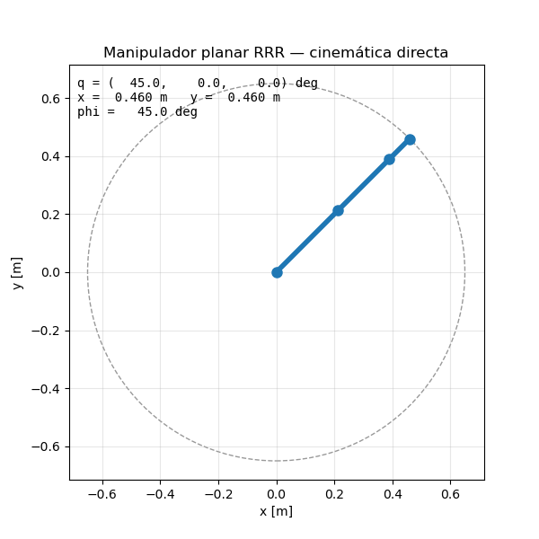

# ros2_manipulator

Manipulador planar RRR (3 GDL) en ROS 2 Lyrical: cinemática, visualización, simulación y planificación.

## Paquetes
| Paquete | Contenido |
|---|---|
| `arm_kinematics` | Modelo Denavit-Hartenberg, cinemática directa, nodo `fk_node` (topic, parámetros y service) y pruebas unitarias |
| `arm_interfaces` | Service `ComputeFK.srv` (ángulos → pose del efector final) |
| `arm_description` | URDF del brazo y visualización en RViz |

## Documentación
- [Cinemática directa por Denavit-Hartenberg](docs/cinematica_directa_DH.md)

## Compilar
~~~bash
cd ~/ros2_ws && colcon build --symlink-install && source install/setup.bash
~~~

## Uso
**Visualizar el brazo en RViz (con deslizadores):**
~~~bash
ros2 launch arm_description display.launch.py
~~~

**Solo el nodo de cinemática directa (parámetros desde `config/params.yaml`):**
~~~bash
ros2 launch arm_kinematics fk.launch.py
~~~

**Calcular la pose con el service:**
~~~bash
ros2 service call /compute_fk arm_interfaces/srv/ComputeFK "{q: [0.5236, 0.7854, -0.5236]}"
~~~

**Animación 2D con matplotlib:**
~~~bash
python3 tools/animate_arm.py                          # ventana
python3 tools/animate_arm.py --save docs/brazo_rrr.gif  # guardar GIF
~~~

**Pruebas unitarias:**
~~~bash
python3 -m pytest arm_kinematics/test/test_kinematics.py -v
~~~

## Topics y services
| Nombre | Tipo | Descripción |
|---|---|---|
| `/joint_states` | `sensor_msgs/JointState` | Ángulos articulares (entrada) |
| `/end_effector_pose` | `geometry_msgs/PoseStamped` | Pose de la punta calculada con DH (salida) |
| `/compute_fk` | `arm_interfaces/srv/ComputeFK` | Cinemática directa bajo demanda |
